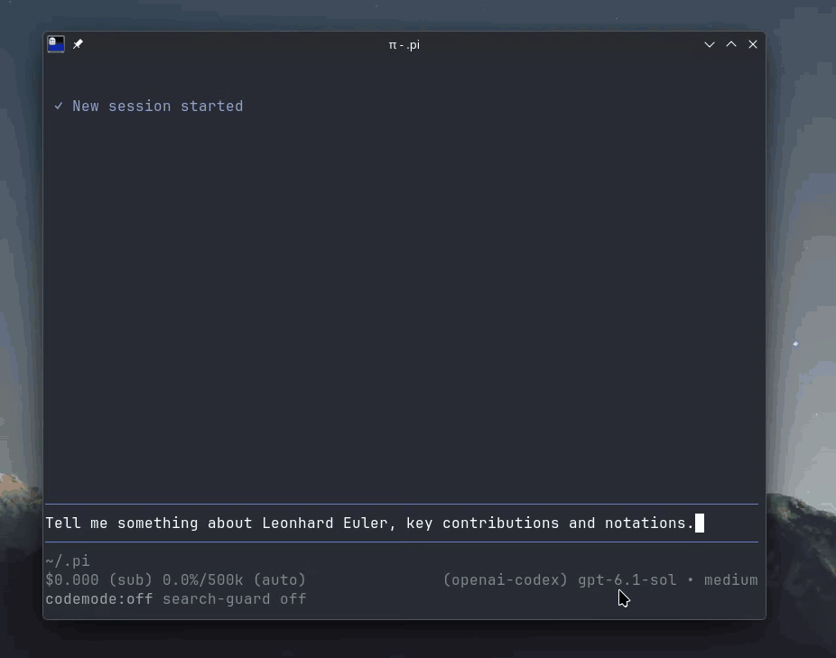

# pi-stretchtext

Stretchtext replies for [Pi](https://pi.dev): the model answers in one to three short sentences, and
the phrases that hold more open in place into longer text, which may hold further phrases to open.



## Install

```bash
pi install git:github.com/MonadicMike/pi-stretchtext
```

Or copy this folder to `~/.pi/agent/extensions/stretchtext/`.

## Set up

Clicking a stretch needs Pi's fullscreen TUI mode. It is Pi's default; if you switched to regular
mode, turn it back on in any of these ways:

- in Pi, open `/settings` and set the TUI mode to `fullscreen`,
- or in `~/.pi/agent/settings.json` set `"tuiMode": "fullscreen"`,
- or start Pi with `pi --tui-mode fullscreen`.

In regular mode the keyboard shortcuts below still work.

## Use

| Action | Fullscreen | Any mode |
|---|---|---|
| Open a stretch | click its underlined short form | `alt+down`, then its letter |
| Close a stretch | click the « after it | `alt+up`, then its letter |

## License

MIT. Based on [cc-stretch](https://github.com/pro-vi/cc-stretch) by pro-vi, also MIT.
